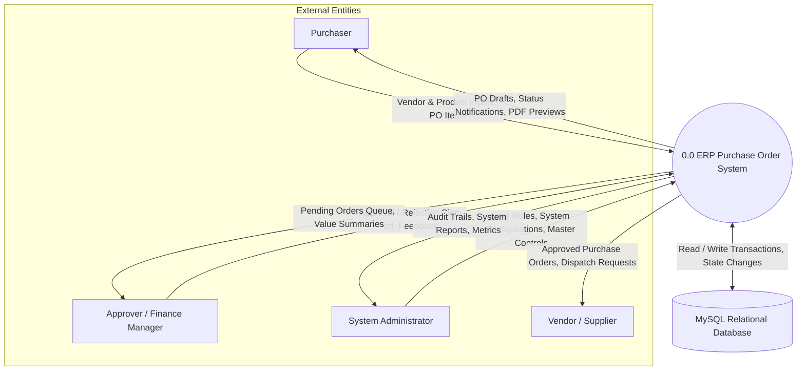
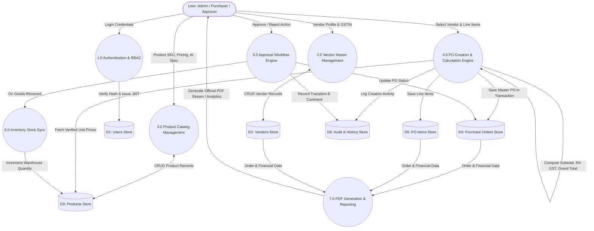

# Data Flow Diagrams (DFD)
## ERP-Based Purchase Order (PO) Management System

### 1. Level 0 DFD (Context Diagram)

The Level 0 Context Diagram represents the entire ERP system as a single central process interacting with external entities (Purchaser, Approver, Admin, Vendor, and MySQL Database).

---

### 2. Level 1 DFD (Decomposed Sub-Processes)

Level 1 breaks down the main system into its functional sub-processes:

