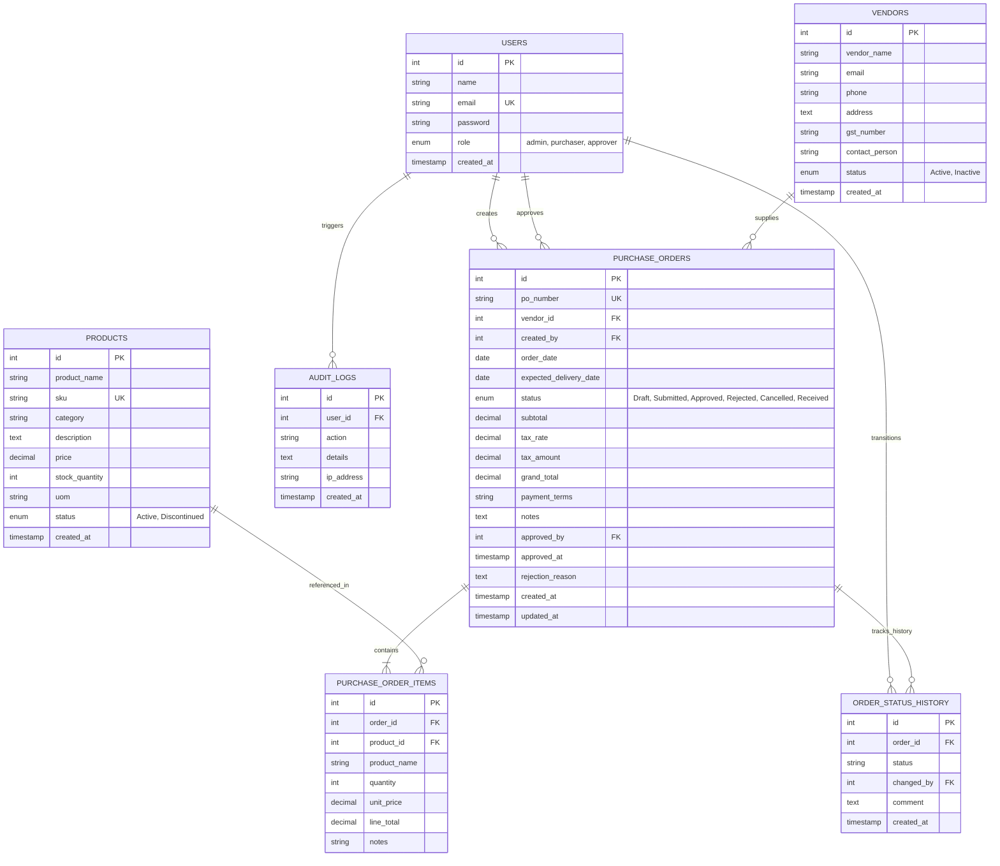

# Entity-Relationship (ER) Diagram & Database Design
## ERP-Based Purchase Order (PO) Management System

### 1. Mermaid Entity-Relationship Diagram

---

### 2. Cardinality & Relationship Breakdown

1. **USERS to PURCHASE_ORDERS (1:M)**
   - Ek user (`purchaser` ya `admin`) multiple Purchase Orders create kar sakta hai (`created_by`).
   - Ek purchase order ka exactly ek hi creator hota hai.
   - Separate relationship: Ek user (`approver` ya `admin`) multiple purchase orders ko sign-off / approve kar sakta hai (`approved_by`).

2. **VENDORS to PURCHASE_ORDERS (1:M)**
   - Ek vendor se company multiple times goods mangwa sakti hai (multiple POs).
   - Har individual purchase order sirf ek specific vendor ke naam issue hota hai.
   - `ON DELETE RESTRICT` constraint laga hai: Agar kisi vendor ke against active orders hain, toh accidental deletion block hoti hai.

3. **PURCHASE_ORDERS to PURCHASE_ORDER_ITEMS (1:M)**
   - Ek Purchase Order ke andar multiple line items (different products) ho sakte hain.
   - `ON DELETE CASCADE` laga hai: Agar Draft order delete hota hai, toh uske line items automatically clean ho jaate hain.

4. **PRODUCTS to PURCHASE_ORDER_ITEMS (1:M)**
   - Ek catalog product multiple purchase orders ke andar repeat ho sakta hai.
   - Unit price and line total are snapshot-stored inside `purchase_order_items` taaki future mein product base price update hone par purani historical orders ki accounting alter na ho!

5. **PURCHASE_ORDERS to ORDER_STATUS_HISTORY (1:M)**
   - Har status transition (`Draft` -> `Submitted` -> `Approved` -> `Received`) ka timestamped audit record store hota hai.

---

### 3. Database Normalization (Viva Explanation)

- **1NF (First Normal Form)**:
  - Har column mein atomic (indivisible) values hain.
  - Multi-valued attributes nahi hain (jaise order table ke andar comma-separated product list daalne ke bajaye humne separate `purchase_order_items` table banaya).
- **2NF (Second Normal Form)**:
  - Table already 1NF mein hai aur har non-key column fully functionally dependent hai primary key par.
  - No partial dependency.
- **3NF (Third Normal Form)**:
  - Koi transitive dependency nahi hai ($A \rightarrow B$ and $B \rightarrow C$).
  - Vendor ki address, GST number, aur phone details `vendors` table mein isolated hain; unhe har order mein duplicate nahi kiya gaya. Sirf `vendor_id` foreign key store hoti hai.
