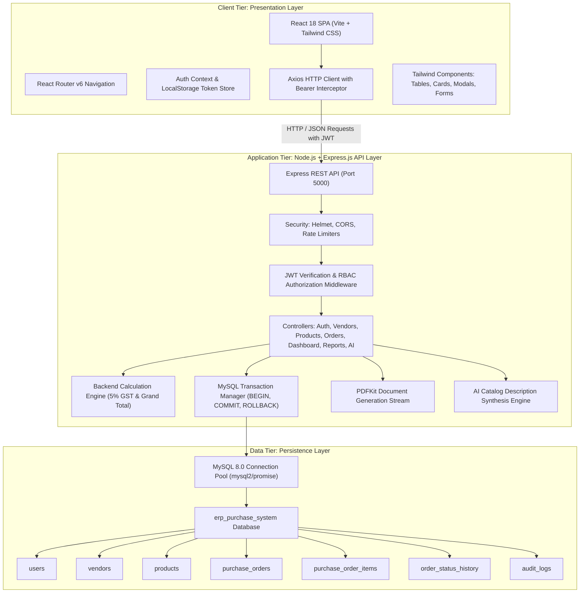

# System Architecture & Technical Specifications
## ERP-Based Purchase Order (PO) Management System

### 1. High-Level 3-Tier Enterprise Architecture

---

### 2. Purchase Order Calculation & Integrity Flow

1. **User Action**: The purchaser adds products to an order in the React UI. The UI provides real-time client-side calculation feedback so the user knows estimated totals.
2. **API Request**: When "Submit" is clicked, React sends **only** `product_id` and `quantity`. Frontend prices and totals are purposefully omitted or ignored by the backend.
3. **Database Lookups**: The Express server queries the `products` table directly in MySQL to obtain the true, certified `price` for every line item.
4. **Calculations Applied**:
   $$\text{LineTotal}_i = \text{Quantity}_i \times \text{DatabasePrice}_i$$
   $$\text{Subtotal} = \sum_{i=1}^n \text{LineTotal}_i$$
   $$\text{TaxAmount} = \text{round}\left(\text{Subtotal} \times \frac{5.00}{100}, 2\right)$$
   $$\text{GrandTotal} = \text{Subtotal} + \text{TaxAmount}$$
5. **ACID Transaction**:
   - `connection.beginTransaction()`
   - Generate collision-safe PO Number (`PO-YYYY-XXXX`) using row locking (`FOR UPDATE`)
   - `INSERT INTO purchase_orders`
   - `INSERT INTO purchase_order_items`
   - `INSERT INTO order_status_history`
   - `INSERT INTO audit_logs`
   - `connection.commit()`
   - If any exception occurs: `connection.rollback()`
